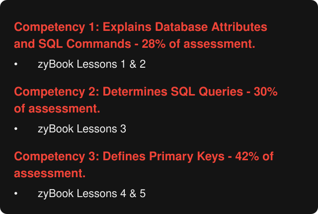

# D426 competencies

The objective assessment is split into three competencies. Here's the course's breakdown, exactly as given:

**On the website:** the [Competencies tab](https://unkwncokonut.github.io/wgu-d426-study-guide/#competencies) shows this with your progress on each competency.

| Competency | Share of exam | zyBook | Guide modules | Study it |
| --- | --- | --- | --- | --- |
| **1. Explains Database Attributes and SQL Commands** | 28% | Lessons 1 & 2 | 1–5 | [Learn](https://unkwncokonut.github.io/wgu-d426-study-guide/#learn/c1) · [Listen](https://unkwncokonut.github.io/wgu-d426-study-guide/#podcast/c1) |
| **2. Determines SQL Queries** | 30% | Lessons 3 | 6–7 | [Learn](https://unkwncokonut.github.io/wgu-d426-study-guide/#learn/c2) · [Listen](https://unkwncokonut.github.io/wgu-d426-study-guide/#podcast/c2) |
| **3. Defines Primary Keys** | **42%** | Lessons 4 & 5 | 8–10 | [Learn](https://unkwncokonut.github.io/wgu-d426-study-guide/#learn/c3) · [Listen](https://unkwncokonut.github.io/wgu-d426-study-guide/#podcast/c3) |

Study the biggest chunk first: Competency 3 → Competency 2 → Competency 1.

## Competency 1: Explains Database Attributes and SQL Commands (28%)

zyBook Lessons 1 & 2

| Topic | Key terms |
| --- | --- |
| **DB basics** | Database application, Database administrator (DBA), Authorization, Query processor, Query optimization, Storage manager, Transaction manager, Catalog, Log, API … |
| **Relational model** | Table, Row, Column, Cell, Empty table, Tuple, Data type, Data independence, Select operation, Project operation … |
| **SQL & data types** | DDL, DQL, DML, DCL, DTL, Literal, Keyword, Identifier, VARCHAR(N), DECIMAL(M, D) … |
| **Core statements** | CREATE TABLE, DROP TABLE, ALTER TABLE, INSERT, UPDATE, DELETE, TRUNCATE, MERGE |
| **Keys & constraints** | Primary key, Composite primary key, Simple primary key, Auto-increment column, Foreign key, Referential integrity, RESTRICT, SET NULL, SET DEFAULT, CASCADE … |

**Guide:** [1. Database basics](guide/01-database-basics.md) · [2. Relational model](guide/02-relational-model.md) · [3. SQL language and data types](guide/03-sql-language-and-types.md) · [4. Core statements](guide/04-core-statements.md) · [5. Keys and constraints](guide/05-keys-and-constraints.md)

**Study it:** [Learn](https://unkwncokonut.github.io/wgu-d426-study-guide/#learn/c1) · [Flashcards](https://unkwncokonut.github.io/wgu-d426-study-guide/#flash/c1) · [Practice questions](https://unkwncokonut.github.io/wgu-d426-study-guide/#test/c1) · [Podcast episode](https://unkwncokonut.github.io/wgu-d426-study-guide/#podcast/c1) · [Quiz show](https://unkwncokonut.github.io/wgu-d426-study-guide/#podcast/quiz-c1)

## Competency 2: Determines SQL Queries (30%)

zyBook Lessons 3

| Topic | Key terms |
| --- | --- |
| **Writing queries** | BETWEEN, LIKE, IN, ORDER BY, Aggregate function, GROUP BY, HAVING, WHERE, Alias, CONCAT … |
| **Joins & views** | Join, INNER JOIN, LEFT JOIN, RIGHT JOIN, FULL JOIN, Outer join, Equijoin, Non-equijoin, Self-join, Cross-join … |

**Guide:** [6. Writing queries](guide/06-writing-queries.md) · [7. Joins, subqueries, and views](guide/07-joins-subqueries-views.md)

**Study it:** [Learn](https://unkwncokonut.github.io/wgu-d426-study-guide/#learn/c2) · [Flashcards](https://unkwncokonut.github.io/wgu-d426-study-guide/#flash/c2) · [Practice questions](https://unkwncokonut.github.io/wgu-d426-study-guide/#test/c2) · [Podcast episode](https://unkwncokonut.github.io/wgu-d426-study-guide/#podcast/c2) · [Quiz show](https://unkwncokonut.github.io/wgu-d426-study-guide/#podcast/quiz-c2)

## Competency 3: Defines Primary Keys (42%)

zyBook Lessons 4 & 5

> [!IMPORTANT]
> The biggest chunk of the exam. It covers zyBook lessons 4 & 5: ER modeling, normalization, and physical design. Primary keys run through all of it, including how each kind of table gets its key.

| Topic | Key terms |
| --- | --- |
| **ER modeling** | Analysis, Logical design, Physical design, Entity, Relationship, Attribute, Reflexive relationship, ER diagram, Cardinality, Relationship maximum … |
| **Keys & normal forms** | Artificial key, Functional dependence, Redundancy, Normal forms, Candidate key, Non-key column, Trivial dependency, First normal form (1NF), Second normal form (2NF), Third normal form (3NF) … |
| **Physical design** | Heap table, Sorted table, Hash table, Bucket, Table cluster, Table scan, Index scan, Hit ratio, Binary search, Dense index … |

**Guide:** [8. Design and ER modeling](guide/08-design-and-er-modeling.md) · [9. Primary keys and normalization](guide/09-normalization.md) · [10. Physical design](guide/10-physical-design.md)

**Study it:** [Learn](https://unkwncokonut.github.io/wgu-d426-study-guide/#learn/c3) · [Flashcards](https://unkwncokonut.github.io/wgu-d426-study-guide/#flash/c3) · [Practice questions](https://unkwncokonut.github.io/wgu-d426-study-guide/#test/c3) · [Podcast episode](https://unkwncokonut.github.io/wgu-d426-study-guide/#podcast/c3) · [Quiz show](https://unkwncokonut.github.io/wgu-d426-study-guide/#podcast/quiz-c3)

## Check yourself

The [exam simulation](https://unkwncokonut.github.io/wgu-d426-study-guide/#test/sim) is 30 questions split by these same weights, scored per competency, so you can see which one needs work.
