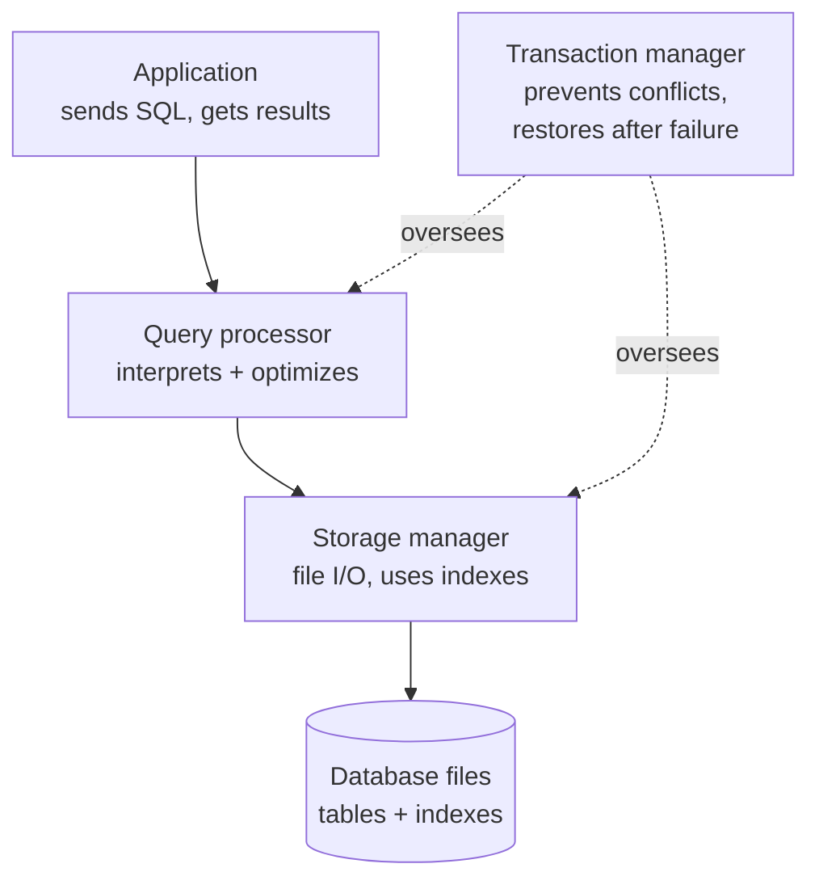

# 1. Database basics

**Time:** 3 minutes

**Exam weight:** Competency 1, Explains Database Attributes and SQL Commands (28% of the exam)

> [!TIP]
> **TL;DR**
> - **Query processor** plans the query. **Storage manager** reads and writes files. **Transaction manager** keeps things consistent.
> - The **DBA** secures the database against unauthorized users.
> - **Authorization** limits users to specific tables, columns, or rows.

## How a query moves through the system

| Component | Job |
| --- | --- |
| **Query processor** | Interprets the query, builds a plan, runs **query optimization**, returns results |
| **Storage manager** | Turns the plan into low-level file-system commands; uses **indexes** to find data fast |
| **Transaction manager** | Prevents conflicts between concurrent transactions; restores consistency after a failure |
| **Log** | Records every insert, update, and delete for recovery |
| **Catalog** (data dictionary) | Metadata about tables, columns, indexes |

## People and rules

- **Database application:** software that helps business users work with a database.
- **Database administrator (DBA):** secures the system and enforces access and availability procedures.
- Other roles: **database designer** (structure), **database programmer** (writes code that uses SQL), **database user** (consumes the data).
- **Rules:** data must stay consistent with structural and business rules.
- **API:** lets Python, Java, and other languages run SQL.
- **MySQL** is relational and open source. **MongoDB** is NoSQL and open source.

> [!WARNING]
> **Exam traps**
> - Query *optimization* belongs to the **query processor**, not the storage manager.
> - Recovery after a crash is the **transaction manager**.

## Quick check

1. Which component translates the plan into file-system commands?

**Storage manager.**

2. Who secures the database against unauthorized users?

**The database administrator (DBA).**

3. What prevents two concurrent transactions from colliding?

**The transaction manager.**

[← All modules](README.md) · [Next: Relational model →](02-relational-model.md)
