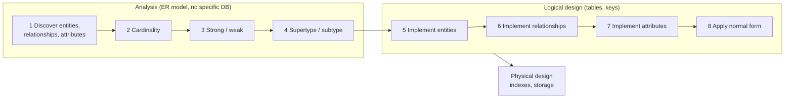

# 8. Design and ER modeling

**Time:** 6 minutes

> [!TIP]
> **TL;DR**
> - Three phases: **Analysis → Logical design → Physical design**.
> - Eight steps: four in analysis, four in logical design. The last analysis step is **supertype/subtype**.
> - Crow's foot: **circle = 0, line = 1, crow's foot = many**.

## Phases and steps

- **Analysis** is also called conceptual design, ER modeling, or requirements definition.
- **Physical design** never changes results, only speed.

## ER building blocks

| Thing | What it is | Becomes |
| --- | --- | --- |
| **Entity** | Person, place, product, concept, activity (rectangle) | Table |
| **Relationship** | A statement about two entities | Foreign key |
| **Attribute** | A descriptive property | Column |

- **Reflexive relationship:** an entity related to itself.
- **Type vs instance:** "all employees" is a type; "Sam Snead" is an instance.
- **Intangible entity:** in the model, but not tracked with data.

## Cardinality

- **Relationship maximum:** the most instances that can relate (one or many).
- **Relationship minimum:** the fewest (zero = optional, one = required).
- **Attribute notation:** `Name 1(1)` = singular, required. `Phone M(0)` = plural, optional.

| Crow's foot | Means |
| --- | --- |
| Circle | Zero |
| Short line | One |
| Three lines | Many |

## Strong, weak, super, sub

- **Strong entity:** has its own identifying attribute.
- **Weak entity:** doesn't; depends on an **identifying relationship** (an order line item depends on its order).
- **Subtype:** a subset of a **supertype** (Manager in Employee). Drawn inside it, linked by an **IsA** relationship.
- **Partition:** a group of **mutually exclusive** subtypes (Car, Truck, Motorcycle in Vehicle).

> [!WARNING]
> **Exam traps**
> - "Apply normal form" is step 8, in **logical design**, not analysis.
> - Weak ≠ intangible. Weak lacks an identifier; intangible isn't stored at all.

## Quick check

1. Last of the four analysis steps?

**Create supertype and subtype entities.**

2. Circle + crow's foot means…?

**Zero or many.**

3. Relationship type becomes what in logical design?

**A foreign key.**

[← Back](07-joins-subqueries-views.md) · [Next: Normalization →](09-normalization.md)
